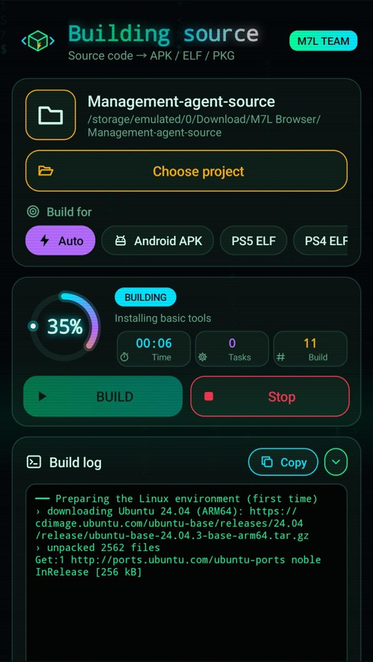
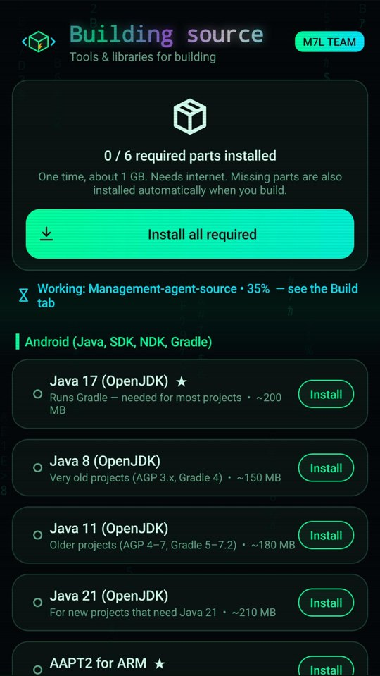
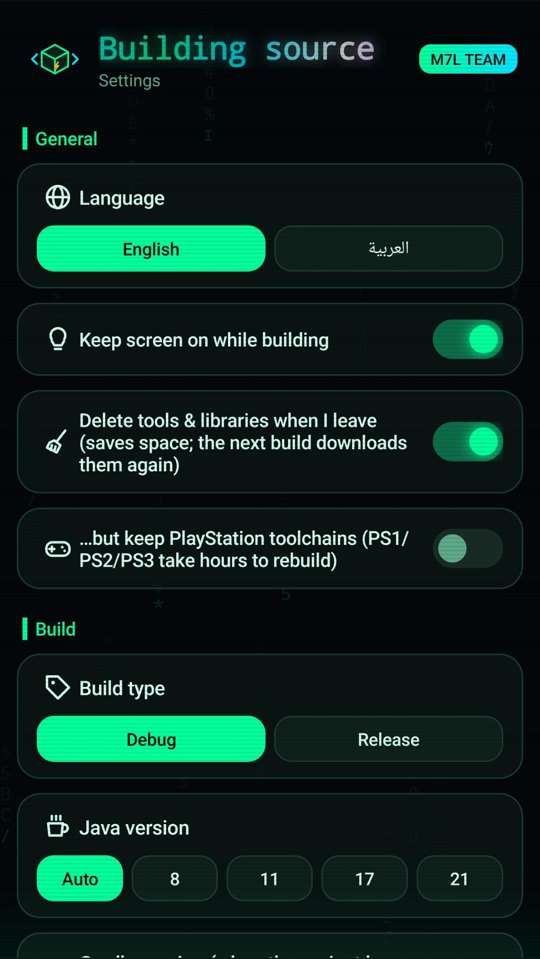
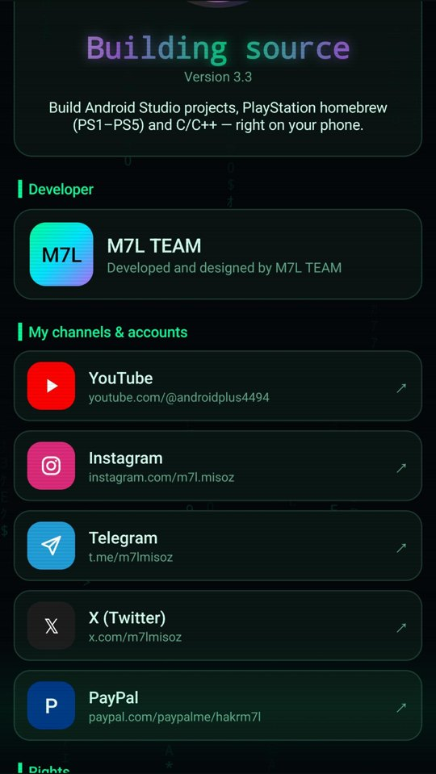

<div align="center">

# ⚡ Building source

**Build Android Studio projects, PlayStation homebrew (PS1–PS5) and C/C++ — right on your phone.**

**جمّع مشاريع أندرويد استوديو وهوم برو بلايستيشن (PS1 إلى PS5) و C/C++ من جوالك مباشرة.**


   

</div>

---

## 📖 نبذة | About

**Building source** يشغّل نظام Ubuntu 24.04 صغير داخل التطبيق (عن طريق PRoot، بدون روت)، ويحوّل السورس كود إلى ملف جاهز:

| المدخل | المخرج |
|---|---|
| مشروع Android Studio / Gradle | **APK** |
| مشروع PS4 / PS5 homebrew | **ELF / PKG** |
| PS1 / PS2 / PS3 | **EXE / ELF / SELF** |
| C / C++ / Rust / Go … | ملف تنفيذي لـ Linux ARM64 |

التطبيق **يتعرّف على نوع المشروع تلقائيًا**، ويحمّل فقط الأدوات اللي يحتاجها المشروع.

*Building source runs a small Ubuntu 24.04 inside the app (via PRoot, no root needed), detects the project type automatically, downloads only the tools it needs, and builds it into an APK, ELF, PKG or a native binary.*

---

## ✨ المميزات | Features

- 🔍 **تعرّف تلقائي** على نوع المشروع (Auto) أو تختار الهدف بنفسك.
- 📂 تختار **مجلد** أو ملف **.zip**، أو تشارك zip من أي تطبيق ثاني.
- 🔄 **البناء يكمل بالخلفية** مع إشعار بالتقدم، ويبلّغك لما يجهز الملف.
- 📜 **سجل بناء مباشر** مع زر نسخ، ونسبة التقدم والوقت وعدد المهام.
- 🛠 **إصلاحات تلقائية** لأشهر أخطاء البناء (CRLF، AAPT2 على ARM، المكتبات الناقصة).
- 📦 **مدير مكتبات**: تثبيت أو حذف كل جزء لحاله، مع "تثبيت كل المطلوب" بضغطة.
- 🧹 **توفير مساحة**: حذف الأدوات بعد الخروج، مع خيار الإبقاء على أدوات بلايستيشن.
- 🗂 **نسخة بناء خاصة**: المشروع الأصلي ما يتغيّر.
- ⚙ **إعدادات متقدمة**: Debug / Release، نسخة Java، نسخة Gradle، ذاكرة Gradle، Offline، تنظيف قبل البناء، أوامر Gradle إضافية، عدد المهام المتوازية.
- 📲 **تثبيت الـAPK مباشرة** بعد البناء، أو مشاركته.
- 🌐 **عربي / English**.
- 📊 **إحصائيات** للبناءات الناجحة والفاشلة.

---

## 🎯 المنصّات المدعومة | Supported targets

| المنصة | الأدوات المستخدمة | يُكتشف من |
|---|---|---|
| **Android APK** | Gradle، Android SDK، Build-Tools، NDK r29، AAPT2 for ARM | `com.android.application` في ملفات gradle |
| **React Native** | Gradle + Node.js | `react-native` في package.json |
| **Flutter** | Flutter SDK (stable) | `pubspec.yaml` فيه flutter |
| **PS5 ELF** | [ps5-payload-sdk](https://github.com/ps5-payload-dev/sdk) | `PS5_PAYLOAD_SDK` / `prospero-clang` |
| **PS4 ELF / PKG** | [OpenOrbis PS4 Toolchain](https://github.com/OpenOrbis/OpenOrbis-PS4-Toolchain) + [LibOrbisPkg](https://github.com/OpenOrbis/LibOrbisPkg) | `OO_PS4_TOOLCHAIN` / `OpenOrbis` |
| **PS3** | [ps3toolchain](https://github.com/ps3dev/ps3toolchain) + [PSL1GHT](https://github.com/ps3dev/PSL1GHT) | `PSL1GHT` / `ppu-gcc` |
| **PS2** | [ps2dev](https://github.com/ps2dev/ps2dev) + [ps2sdk](https://github.com/ps2dev/ps2sdk) | `PS2SDK` / `ee-gcc` |
| **PS1** | [PSn00bSDK](https://github.com/Lameguy64/PSn00bSDK) + GCC mipsel | `PSn00bSDK` |
| **C / C++** | clang، make، CMake، Ninja، Meson، Autotools، SCons، xmake | `CMakeLists.txt` / `Makefile` / `meson.build` … |
| **Rust** | rustup + cargo | `Cargo.toml` |
| **Go** | golang-go | `go.mod` |
| **Node.js** | Node.js (آخر LTS) | `package.json` |
| **Python** | python3 + pip + venv | `pyproject.toml` / `setup.py` / `requirements.txt` |
| **Java** | Maven، Gradle، Ant | `pom.xml` / `build.gradle` / `build.xml` |
| **.NET** | .NET SDK 8.0 | `.sln` / `.csproj` / `.fsproj` |
| **Zig / Nim / Dart / Haskell** | Zig 0.14، Nim، Dart SDK، GHC + Cabal | `build.zig` / `.nimble` / `pubspec.yaml` / `.cabal` |
| **Scripts** | `build.sh`، `build.py`، justfile، build.ninja | سكربت بناء في المجلد |

---

## 📦 المكتبات والأدوات | Libraries & tools

### Android
| الجزء | الوصف |
|---|---|
| Java 17 (OpenJDK) ⭐ | يشغّل Gradle، وتحتاجه أغلب المشاريع |
| Java 8 / 11 / 21 | للمشاريع القديمة (AGP 3.x – 7) والحديثة |
| AAPT2 for ARM ⭐ | نسخة AAPT2 تشتغل على معالجات ARM |
| Android SDK cmdline-tools | `sdkmanager` والتراخيص |
| Platforms | Android 21 → 35 |
| Build-Tools | 30.0.3، 33.0.2، 34.0.0، 35.0.0 |
| NDK | r29 (aarch64) |
| Gradle | 8.14.3، و 4.10.3 / 5.6.4 / 6.9.4 / 7.6.4 للمشاريع القديمة |

### مكتبات M7L للمشاريع | M7L project libraries
تنزل تلقائيًا إذا المشروع يستخدمها (مثل `dr_mp3.h`، `stb_*.h`، `imgui.h`، `miniz.h`):

`DOSBox` · `pcsx_rearmed` · `PCSX2` · `DaedalusX64` · `dr_libs` · `stb` · `Dear ImGui` · `glslang` · `shaderc` · `rapidyaml` · `SDL2` · `miniz` · `libchdr` · `zstd` · `Mesa` · `OpenOrbis` · `PSL1GHT` · `ps2sdk` · `Termux`

### مكتبات التطوير | Dev libraries
SDL2 (image / ttf / mixer)، OpenGL، EGL، GLEW، GLFW، Vulkan، X11، curl، OpenSSL، zlib، libpng، libjpeg، FreeType، zstd، lzma، bzip2، SQLite، ncurses، OpenAL، Ogg / Vorbis / FLAC / Opus، ALSA، PulseAudio، fmt، nlohmann-json، GLM، Eigen، yaml-cpp، libusb، libxml2، libarchive.

> لما CMake أو pkg-config يطلب مكتبة ناقصة، التطبيق يثبّت حزمة `-dev` المناسبة لها تلقائيًا (Boost، FFmpeg، SFML، Protobuf، Lua، Wayland وغيرها).

---

## ⏳ ملاحظة مهمة عن وقت البناء | Build time notice

> [!IMPORTANT]
> **البناء ممكن ياخذ وقت، خاصة أول مرة.**
> التطبيق خفيف وما فيه أي أدوات أو مكتبات جاهزة داخله. كل شي يحتاجه المشروع (Ubuntu، Java، Android SDK، Gradle، NDK، أدوات بلايستيشن والمكتبات) **ينزل أونلاين من مصادره الرسمية وقت البناء**.
>
> - ⏱ **أول بناء:** يحمّل Ubuntu والأدوات المطلوبة (حوالي 1 GB لأندرويد)، وحسب سرعة النت ممكن ياخذ من دقائق إلى أكثر من ساعة.
> - 🎮 **PS1 / PS2 / PS3:** أدواتها تنبني من السورس أول مرة، وممكن تاخذ **ساعات**.
> - ⚡ **البناءات اللي بعدها أسرع بكثير**، لأن الأدوات تكون محمّلة من قبل.
> - 🧹 إذا كان خيار **"حذف الأدوات عند الخروج"** شغّال، البناء الجاي بيحمّل كل شي من جديد. طفّه إذا تبي البناء يكون أسرع.
> - 📶 استخدم **Wi-Fi** سريع وثابت، وخلّ الجوال على الشاحن أثناء أول بناء.
> - 📴 بعد التحميل تقدر تفعّل **Offline mode** عشان يستخدم المكتبات المحمّلة بس.

> **English:** Building can take a while, especially the first time. The app ships with no tools inside — Ubuntu, Java, the Android SDK, Gradle, the NDK, the PlayStation toolchains and all required libraries are **downloaded online from their official sources during the build**. The first build may take from minutes to over an hour depending on your connection (PS1/PS2/PS3 toolchains can take hours). Later builds are much faster because the tools are already downloaded — unless "Delete tools & libraries when I leave" is on.

---

## 🚀 طريقة الاستخدام | How to use

1. ثبّت التطبيق، واسمح بـ **الوصول للملفات** و**التشغيل بالخلفية**.
2. من تبويب **Build** اضغط **Choose project**، واختر مجلد المشروع أو ملف **.zip**.
3. اترك **Build for** على **Auto**، أو اختر الهدف (Android APK / PS5 ELF / PS4 ELF …).
4. اضغط **BUILD** ▶.
5. أول مرة يجهّز Ubuntu داخل التطبيق ويحمّل الأدوات المطلوبة (يحتاج إنترنت، تقريبًا 1 GB لأدوات أندرويد).
6. الملفات الناتجة تنحفظ في مجلد **`Building source/APK`**، وتقدر تثبّتها أو تشاركها مباشرة.

> 💡 تبويب **Libraries** يخلّيك تثبّت الأدوات مسبقًا، أو تحذف اللي ما تحتاجه عشان توفّر مساحة.
>
> ⏳ أدوات PS1 / PS2 / PS3 تنبني من السورس أول مرة، وممكن تاخذ ساعات.

**English:** Allow storage and background running → **Choose project** (folder or .zip) → keep **Auto** or pick a target → **BUILD**. The first build sets up Ubuntu and downloads only what the project needs. Results are saved in `Building source/APK`.

---

## 📱 المتطلبات | Requirements

- جوال **64-bit ARM (arm64-v8a)**.
- **Android 8.0+** (API 26).
- إنترنت لأول بناء.
- مساحة فاضية: ~1 GB لأندرويد، وأكثر لأدوات بلايستيشن.

---

## 🧩 بناء التطبيق من السورس | Build this app from source

| | |
|---|---|
| Package | `com.m7l.buildingsource` |
| Version | 3.3 (code 13) |
| compileSdk / minSdk / targetSdk | 36 / 26 / 28 |
| Android Gradle Plugin | 8.13.2 |
| Gradle | 9.2.1 |
| Java | 17 |
| Dependency | `androidx.core:core:1.13.1` |

> `targetSdk 28` مقصود: يسمح للتطبيق يشغّل أدوات Linux اللي يحمّلها داخل مجلده.

**على ويندوز:**
```bat
build-app.bat
```
يشغّل `fetch-proot.ps1` (يحمّل PRoot و libtalloc و libandroid-shmem من مستودع Termux إلى `app/src/main/jniLibs/arm64-v8a`)، وبعدين `gradlew assembleDebug`، وينسخ الـAPK إلى مجلد `APK`.

**يدويًا:**
```bash
powershell -File fetch-proot.ps1     # مرة وحدة
./gradlew assembleDebug
```

### هيكل السورس | Source layout
```
app/src/main/
├── java/com/m7l/buildingsource/
│   ├── MainActivity.java    # الواجهة: Build · Libraries · Settings · About
│   ├── BuildService.java    # خدمة البناء في الخلفية + الإشعارات
│   ├── Env.java             # تجهيز Ubuntu و PRoot
│   ├── Fx.java              # التأثيرات والحركات
│   └── Icons.java           # الأيقونات المرسومة بالكود
└── assets/bsource/
    ├── build.sh             # تسلسل البناء واكتشاف المشروع
    ├── common.sh            # Android SDK / NDK / Gradle / AAPT2
    ├── ps.sh                # أدوات PS1 – PS5
    ├── langs.sh             # Rust, Node, .NET, Zig … ومكتبات M7L
    └── libs.sh              # تثبيت وحذف الأجزاء
```

---

## 🔗 المصادر | Sources & credits

التطبيق يحمّل هذه الأدوات من مصادرها الرسمية وقت الحاجة. كل أداة تابعة لأصحابها وبرخصتها.

| الأداة | المصدر |
|---|---|
| PRoot (GPLv2) | [termux/proot](https://github.com/termux/proot) · [packages.termux.dev](https://packages.termux.dev/apt/termux-main) |
| Ubuntu Base 24.04 ARM64 | [cdimage.ubuntu.com](https://cdimage.ubuntu.com/ubuntu-base/releases/24.04/release/) |
| Android SDK cmdline-tools | [dl.google.com](https://developer.android.com/studio#command-line-tools-only) |
| Android SDK / NDK لـ aarch64 | [lzhiyong/termux-ndk](https://github.com/lzhiyong/termux-ndk) · [SnowNF/ndk-aarch64-linux](https://github.com/SnowNF/ndk-aarch64-linux) |
| Gradle | [services.gradle.org](https://services.gradle.org/distributions/) |
| PS5 | [ps5-payload-dev/sdk](https://github.com/ps5-payload-dev/sdk) |
| PS4 | [OpenOrbis-PS4-Toolchain](https://github.com/OpenOrbis/OpenOrbis-PS4-Toolchain) · [LibOrbisPkg](https://github.com/OpenOrbis/LibOrbisPkg) · [create-fself](https://github.com/OpenOrbis/create-fself) · [create-gp4](https://github.com/OpenOrbis/create-gp4) |
| PS3 | [ps3dev/ps3toolchain](https://github.com/ps3dev/ps3toolchain) · [ps3dev/PSL1GHT](https://github.com/ps3dev/PSL1GHT) |
| PS2 | [ps2dev/ps2dev](https://github.com/ps2dev/ps2dev) · [ps2dev/ps2sdk](https://github.com/ps2dev/ps2sdk) |
| PS1 | [Lameguy64/PSn00bSDK](https://github.com/Lameguy64/PSn00bSDK) · [GNU binutils](https://ftpmirror.gnu.org/gnu/binutils/) · [GNU GCC](https://ftpmirror.gnu.org/gnu/gcc/) |
| Rust | [rustup.rs](https://rustup.rs) |
| Node.js | [nodejs.org](https://nodejs.org/dist/) |
| .NET | [dot.net](https://dotnet.microsoft.com/download) |
| Zig | [ziglang.org](https://ziglang.org/download/) |
| Dart | [dart.dev](https://dart.dev/get-dart/archive) |
| Flutter | [flutter/flutter](https://github.com/flutter/flutter) |
| Fonts | [google/fonts](https://github.com/google/fonts) |
| DOSBox | [dosbox 0.74-3](https://sourceforge.net/projects/dosbox/) |
| pcsx_rearmed | [libretro/pcsx_rearmed](https://github.com/libretro/pcsx_rearmed) |
| PCSX2 | [PCSX2/pcsx2](https://github.com/PCSX2/pcsx2) |
| DaedalusX64 | [masterfeizz/DaedalusX64-libretro](https://github.com/masterfeizz/DaedalusX64-libretro) |
| dr_libs | [mackron/dr_libs](https://github.com/mackron/dr_libs) |
| stb | [nothings/stb](https://github.com/nothings/stb) |
| Dear ImGui | [ocornut/imgui](https://github.com/ocornut/imgui) |
| glslang | [KhronosGroup/glslang](https://github.com/KhronosGroup/glslang) |
| shaderc | [google/shaderc](https://github.com/google/shaderc) |
| rapidyaml | [biojppm/rapidyaml](https://github.com/biojppm/rapidyaml) |
| SDL2 | [libsdl-org/SDL](https://github.com/libsdl-org/SDL) |
| miniz | [richgel999/miniz](https://github.com/richgel999/miniz) |
| libchdr | [rtissera/libchdr](https://github.com/rtissera/libchdr) |
| zstd | [facebook/zstd](https://github.com/facebook/zstd) |
| Mesa | [gitlab.freedesktop.org/mesa](https://gitlab.freedesktop.org/mesa/mesa) |
| Termux | [termux/termux-app](https://github.com/termux/termux-app) |

> ⚖ **الرخص:** DOSBox و pcsx_rearmed برخصة GPL v2، و PCSX2 برخصة GPL v3 (لازم تنشر السورس إذا نشرت شي مبني عليها). stb و dr_libs و miniz: Public domain أو MIT. Android و Gradle و OpenJDK و Android SDK وأدوات بلايستيشن ملك أصحابها.

---

## 👤 المطوّر | Developer

<div align="center">

### M7L TEAM
**Developed and designed by M7L TEAM**

[](https://youtube.com/@androidplus4494)
[](https://www.instagram.com/m7l.misoz)
[](https://t.me/m7lmisoz)
[](https://x.com/m7lmisoz)
[](https://www.paypal.com/paypalme/hakrm7l)

</div>

---

## ©️ الحقوق | Rights

**© 2026 M7L TEAM — Building source**

الاسم والتصميم والأيقونة من **M7L TEAM**. جميع الحقوق محفوظة.
يُمنع نسخ التطبيق أو إعادة نشره أو نسبه لغير مطوّره بدون إذن.

*Name, design and icon by M7L TEAM. All rights reserved.*
*Uses PRoot (GPLv2) and Ubuntu. Android, Gradle, OpenJDK, the Android SDK and the PlayStation SDKs belong to their owners.*

<div align="center">

⭐ إذا عجبك المشروع لا تنسى تعطيه نجمة ⭐

</div>
